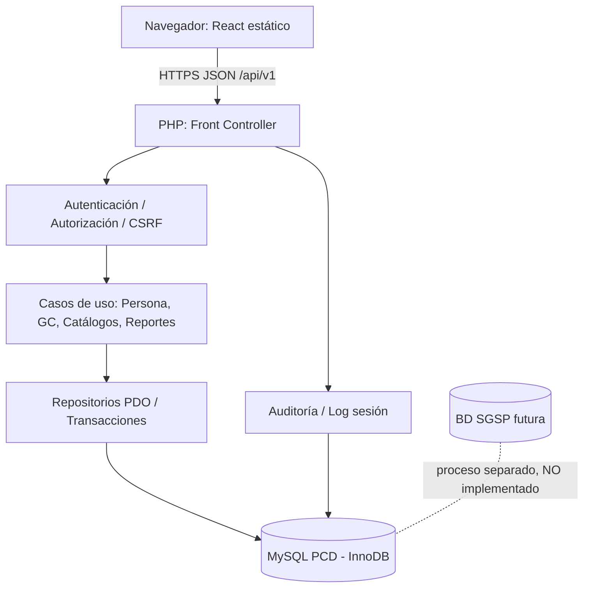

# ARQ-PCD-4.0 · Arquitectura de solución
## Decisión arquitectónica
Monolito modular desplegado en hosting compartido existente con cPanel. Frontend React+TypeScript+Vite **compilado**; backend PHP 8.x con PDO y servicios REST; MySQL/MariaDB InnoDB. Sin procesos Node residentes, microservicios, Redis, Docker ni infraestructura adicional.

## Módulos de frontend
- Login (presbiterio, usuario, contraseña).
- Contexto (sede y alta integrada).
- Personas (formulario secuencial + detección coincidencias).
- GC (solo después de Persona o desde consulta).
- Consulta/corrección.
- Calidad configurada.
- Usuarios.
- Reportes + auditoría autorizada.

Separar componentes de formularios/validaciones del cliente HTTP; catálogos estáticos con cache local **no sensible** por versión. Nunca PII ni tokens sensibles en localStorage. Cookies de sesión `HttpOnly; Secure; SameSite=Lax` según contexto, tokens CSRF obligatorios para escrituras.

## PHP backend
`public/api/index.php` (único punto de entrada), rutas, middlewares, controladores, servicios de aplicación, repositorios PDO, respuestas JSON/versionadas. Scripts sensibles y config fuera de `public_html` (si cPanel permite) y credenciales en variables de entorno o archivo secreto fuera del webroot. Prepared statements, autorización por funcionalidad y edición por autor, límites, transacciones breves.

## Operación crítica Guardar Persona
1. Validar sesión, permiso, sede/presbiterio, token CSRF e idempotencia.
2. Validar estructura, normalizar identidad, reconsultar documento/index.
3. En una transacción: insertar/actualizar Persona, ficha (con secciones de cónyuge/responsabilidades dentro de JSON), auditoría y clave idempotente.
4. Confirmar; retornar ID estable y estado calidad; solo entonces mostrar éxito.
5. Si fallo, rollback completo, error estable (sin filtración datos).

## Restricción de entorno
`https://pcd.unobdata.com` mismo origen React/PHP. CSS/JS con hashes para cache larga; HTML sin cache larga. API y HTML atrás de TLS, no enviar coordenadas en URL. BD accesible únicamente por servidor.

## Observabilidad mínima
Logs estructurados (request_id, endpoint, duración, status, user_id opcional, sin PII); métricas p50/p95 por endpoint; MySQL slow query log si proveedor permite; auditoría persistente en tablas. No IO pesado durante digitación.

## Integración con SGSP
PCD **no** usa esquema físico SGSP. Conservar IDs/fecha origen y datos de ficha para un ETL futuro diseñado por separado.

## Restricción arquitectónica V4.0
MySQL PCD contiene **11 tablas**: organizacion (presbiterio+sede), usuario, sesion (con GPS), login_evento, catalogo (tabla de tablas), ubigeo (INEI entrada I02), persona, ficha (fuente JSON), grupo_crecer, auditoria_evento e idempotencia. No crear tablas por catálogos menores. Consultas por funcionalidad con **filtros opcionales presbiterio/sede**, sin permisos territoriales de lectura. Solo tipo+número documental. [Modelo](../03-base-datos/modelo-logico.md).
