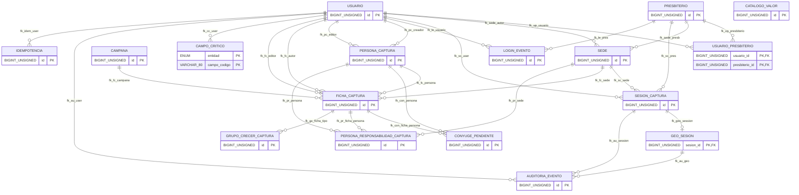
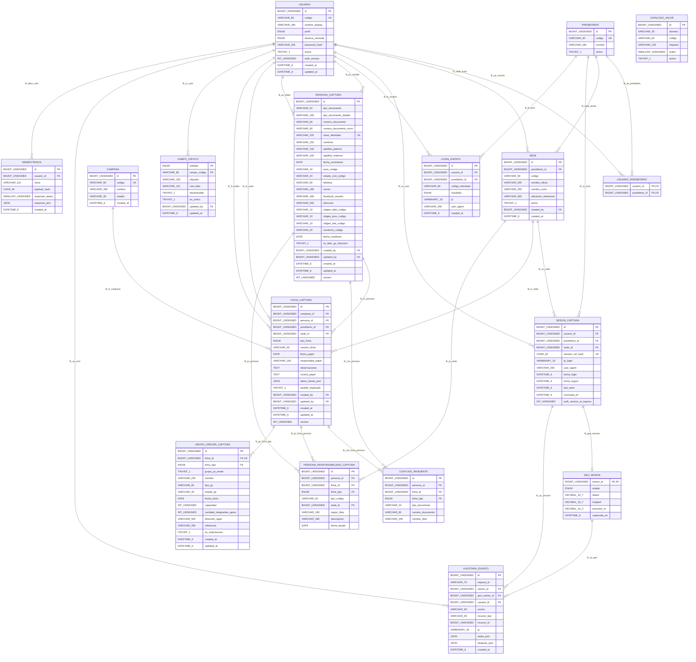

# Anexo 01 — Diagrama físico de PCD

**Fuente única:** [SQL](../../../database/migrations/001_initial.sql); **17 tablas, 165 columnas, 28 FK**. BD temporal propia de PCD, no SGSP.

[Anexo 02: Diccionario físico](anexo-02-diccionario-fisico.md) · [Fuente Mermaid editable](../diagramas/er-pcd-fisico.mmd)

## Vista global

## Diagrama con todos los campos y FK

**Advertencia:** líder GC se obtiene de `ficha_captura.persona_id`, sin integrantes nominales. La lectura `GENERAL/PRESBITERIO` no altera derechos de modificación. Modelo sin ejecución MySQL real.
