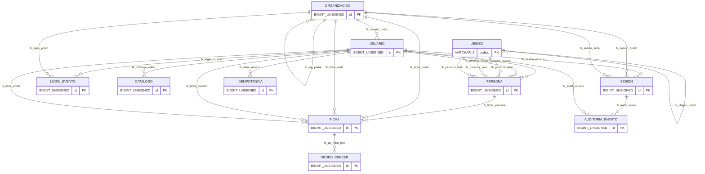
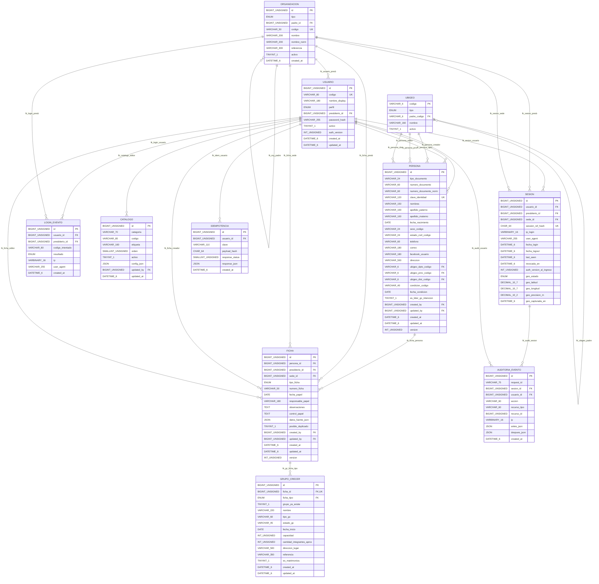

# Anexo 01 — Diagrama físico PCD V4.0 (11 tablas)

**Fuente de verdad:** [migración inicial SQL](../../../database/migrations/001_initial.sql). **11 tablas, 134 columnas, 23 FK**. Producto temporal PCD (no SGSP).

[Diccionario completo](anexo-02-diccionario-fisico.md) · [Fuente editable Mermaid](../diagramas/er-pcd-fisico.mmd)

## Mapa de entidades

## Diagrama detallado de atributos y relaciones

**Notas:** ORGANIZACION combina presbiterio/sede con jerarquía. CATALOGO combina listas y configuración de campos críticos. UBIGEO es una tabla jerárquica específica. FICHA guarda secciones de cónyuge/responsabilidades como JSON; PERSONA mantiene identidad separada. SESION integra geolocalización opcional. El líder GC se obtiene desde FICHA.persona_id. No hay subtipo documental ni tabla de ámbito de consulta.

**Pendiente:** probar CHECK y FK compuestas en el motor de hosting y regenerar anexos después de modificar el SQL.
